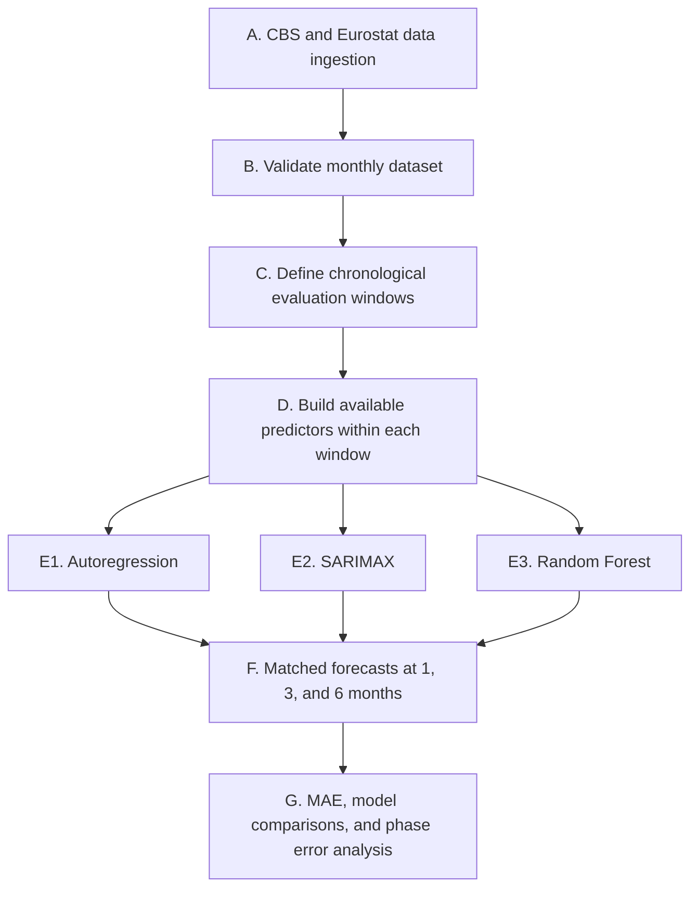

# Methodology Overview
Forecasting Intra-EU Migration to the Netherlands  
Benjamin Mikus

## 1. Purpose and research strategy

This Methodology Overview describes the research design for forecasting monthly immigration associated with selected European Union countries into the Netherlands. It explains the data preparation, statistical and machine learning models, and evaluation procedures through which the research questions will be investigated.

The literature review identifies evidence that migration history and economic conditions are informative for migration forecasting, while leaving uncertainty about their predictive value for monthly intra-EU immigration into the Netherlands. It also motivates comparing machine learning with statistical benchmarks and examining performance under different Dutch business-cycle conditions. This study will contribute evidence on when additional indicators and model complexity improve forecasting performance, including cases where they do not.

The overarching research question is: **To what extent do statistical and machine learning models, supplemented with economic indicators, improve forecasts of monthly immigration associated with selected EU countries into the Netherlands at one-, three-, and six-month horizons, and how does their performance vary across Dutch business-cycle phases?**

The following subquestions operationalize this question:

- **RQ1:** How does the forecasting performance of Random Forest compare with autoregression and SARIMAX when predicting monthly immigration one, three, and six months ahead?
- **RQ2:** Is MAE greater during unfavorable Dutch business-cycle phases than during favorable phases, and how does relative model performance vary between these phases?
- **RQ3:** How does adding origin-country and destination-country economic indicators beyond immigration history and Dutch business-cycle conditions affect out-of-sample forecasting accuracy?

The initial pipeline is developed using data from Poland and will later be extended
to additional selected countries. The current Poland dataset is therefore the
development scope, rather than evidence supporting generalization to all EU
countries. Pooled cross-country modelling is outside the present design.

Supporting materials in this repository include the [literature review](Literature%20Review.md), the [project README](../README.md), the [dataset README](../data/README.md), and the exploratory [baseline notebook](../notebooks/baseline.ipynb). The runnable baseline is implemented in `src/` and orchestrated through the `Makefile`. The separate [data-building repository](https://github.com/ben-mikus/nl-immigration-data) documents assembly of the derived input panel.

## 2. Pipeline overview and implementation status

Figure 1 summarizes the planned pipeline. Model fitting and feature preparation are repeated within each chronological evaluation window.

*Figure 1. Planned forecasting and evaluation pipeline.*

The implemented proof of concept is an autoregressive baseline. `src/data.py`, `src/split.py`, `src/train.py`, `src/predict.py`, and `src/results.py` form a runnable pipeline, invoked with `make all`. It downloads the development dataset, reserves the final six months as a holdout set, fits `AutoREG` from `sktime`, reports MAE at one-, three-, and six-month horizons, and saves a forecast comparison chart. SARIMAX, Random Forest, and the wider pipeline described below are planned components, not completed implementations.

## 3. Data sources, access, and scope: stages A and B

### 3.1 Current development dataset

While in development, the current dataset contains metrics between Poland and the Netherlands across 192 monthly observations from January 2010 through December 2025 and eight columns. The current development dataset does not contain missing values or duplicates. 

| Column | Role and interpretation | Original frequency |
| --- | --- | --- |
| `Period` | Observation month encoded as YYYYMM; converted to a monthly date index | Monthly |
| `Country` | Country identifier; Poland in the development dataset | Identifier |
| `Immigration` | CBS immigration count for the configured Polish origin/migration-background category; prediction target | Monthly |
| `Country-MINWAGE` | Polish statutory minimum wage in purchasing-power standards | Semi-Annually |
| `NL-MINWAGE` | Dutch statutory minimum wage in purchasing-power standards | Semi-Annually |
| `Country-WAGESAL` | Polish wages-and-salaries Labour Cost Index, seasonally and calendar adjusted, 2020=100 | Quarterly |
| `NL-WAGESAL` | Corresponding Dutch Labour Cost Index | Quarterly |
| `NL-CONJCLK` | Dutch Conjunctuurklok business-cycle indicator | Monthly |

All eight columns support the workflow. `Period` provides ordering and calendar features; `Country` identifies the series; `Immigration` is the variable to be predicted; the economic indicators represent what the literature review deemed as the most influential explanatory variables in the setting of Intra-EU migration forecasting.

Minimum wages represent legal minimum wages, not average earnings. The Labour Cost Index measures changes relative to a national reference year, so differences between Polish and Dutch index levels cannot be interpreted as differences in actual wages. Conjunctuurklok measures Dutch business-cycle conditions and encompasses more than GDP growth alone. These distinctions constrain the interpretation of RQ3.

### 3.2 Collection and reproducible access

The dataset has been produced by a separate repository that combines the CBS
immigration tables `85484NED` and `83518NED`, Eurostat minimum-wage data
`earn_mw_cur`, Eurostat wages-and-salaries data `lc_lci_r2_q`, and a downloaded
CBS Conjunctuurklok file. This repository retrieves the derived panel from
GitHub through `make data`; its [data README](../data/README.md) records the
source filters and dataset limitations. Quarterly values are repeated across
their three constituent months and half-yearly values across six months. This
aligns frequencies but does not create independent monthly economic
measurements.

The current capstone pipeline makes the derived development panel reproducibly
available through `make data`. Rebuilding that panel directly from the
underlying CBS and Eurostat sources remains the responsibility of the separate
data-building repository.

The CBS configuration uses origin and migration-background classifications, with birth-country and generation selections. Consequently, the target must not automatically be described as Polish nationality, previous residence in Poland, or labor migration. Before substantive interpretation, source metadata will be checked to establish the precise population measured and comparability across the two CBS tables. Any definition change or overlap will be documented and handled explicitly.

### 3.3 Representativeness and ethical considerations

The study uses public aggregate statistics, without individual-level records in the supplied panel. Therefore, the principal ethical concerns are measurement, representation, and interpretation. Aggregate forecasts cannot establish individual migration motives or support conclusions about individual demographic groups. Country-associated categories must be reported according to their verified statistical definitions, without attributing predictive associations to intrinsic characteristics of national groups.

Furthermore, the Poland development sample cannot represent every EU country, though this will not be a problem as additional countries are processed in the final pipeline. Descriptive statistics and errors will be reported separately by country when the study expands. The supplied panel aggregates sex and does not support sex- or ethnicity-specific error analysis; this limitation will be stated rather than implying that subgroup fairness has been evaluated. Relevant ELSA consultation findings will be incorporated when available.

## 4. Exploratory analysis and preprocessing: stage B

The exploratory [baseline notebook](../notebooks/baseline.ipynb) examines the
development data and supports the initial autoregressive specification. The
results suggest short-term persistence, annual recurrence in immigration,
changing trends, and country-specific relationships. These observations
motivate immigration lags, explicit seasonal modeling, chronological
evaluation, and comparison with a nonlinear model. They do not establish
causality or prove that any predictor improves forecasts.

Observations will be ordered by country. Neither missing target nor missing economic value observations will be silently filled or treated as zero. Instead, their cause will be investigated and affected evaluation windows documented. Initial rows unavailable because of lag construction will be recorded. Valid extreme immigration observations will be retained, with errors examined during volatile periods.

The primary specification will forecast immigration counts on their original scale. A log-transformed target or selected predictor changes may be considered as validation-only alternatives if updated EDA supports them. Transformation choices will be fixed before final testing, and all forecasts will be evaluated on the original count scale. Full-series STL components will remain descriptive; they will not be supplied to models because their estimation can use later observations and create data leakage.

## 5. Predictor information and leakage prevention: stage D

In practicality, predictor belonging to forecast origin *t* are not always available at time *t* due to publication delay. Quarterly Labour Cost Index values, for example, cannot simply be assigned to earlier months of a quarter and treated as already known. The final pipeline will therefore account for each indicator's publication delay before lagged features are generated, using documented release delays and carrying forward the latest released economic observation where appropriate.

Three predefined information sets will support the research questions:

| Information set | Included information | Purpose |
| --- | --- | --- |
| A | Immigration history and common calendar information where applicable | Assess forecasting gains without added economic information |
| B | Set A plus Dutch Conjunctuurklok information | Establish the business-cycle comparator |
| C | Set B plus Polish and Dutch minimum wages and Labour Cost Indices | Assess the incremental value of wage indicators |

AR supplies the historical-immigration benchmark. SARIMAX and Random Forest will be evaluated with sets A, B, and C; set A corresponds to the no-exogenous-predictor SARIMA specification within the SARIMAX framework. Individual wage indicators may be explored within validation, but the predefined full-set comparison will remain visible so that exploratory feature selection does not obscure RQ3.

Future realized economic observations will not be supplied to forecasts. SARIMAX will initially use a carry-forward path based on the latest available economic value for the required future inputs. Random Forest will use separate direct horizon models based on information available at *t* to predict immigration at *t+h*. Differences in these forecasting strategies will be documented when interpreting model comparisons.

The existing sources may contain retrospectively revised values, and the supplied panel has no real-time vintages. Release-delay alignment can reduce look-ahead leakage but cannot recreate historical vintages. Unless vintage data are obtained, evaluation will be described as a retrospective, release-delay-adjusted forecasting exercise. This limits claims about performance in a fully real-time operational setting.

## 6. Chronological validation and final testing: stage C

The following is the planned development split for Poland; it is not the
current baseline evaluation split:

| Period | Role |
| --- | --- |
| January 2010–December 2017 | Initial training history |
| January 2018–December 2022 | Walk-forward validation target months |
| January 2023–December 2025 | Reserved final-test target months |

An expanding training window is preferred initially because the sample contains only 192 months and discarding older observations would reduce training information. A rolling-window alternative may be assessed during validation if structural change materially reduces performance, but it will not be selected using final-test errors.

For each horizon *h* in {1, 3, 6}, a target month is forecast from *h* months earlier. Thus January 2023 is forecast from December 2022 at *h=*1 and from July 2022 at *h=6*. Direct Random Forest training examples are included only when their outcome has become available by that origin. This prevents future training labels from leaking into longer-horizon models.

## 7. Models and methodological alternatives: stage E

### 7.1 Autoregressive baseline

The scientific baseline is an autoregressive model estimated by ordinary least
squares using `sktime` `AutoREG`. The implemented
[`train_baseline`](../src/models/baseline.py) function fits
`AutoREG(lags=18, trend="c")` to the chronological training series. The current
pipeline reserves the final six monthly observations as a terminal holdout and
generates forecasts for horizons one through six.

This baseline tests how much forecast accuracy can be obtained from immigration history alone. Its strengths are transparency and limited complexity. Its limitations include linear dynamics and the absence of economic predictors. The current terminal-holdout experiment is a baseline implementation. It will
be replaced by the planned walk-forward MAE evaluation rather than treated as
the completed evaluation design.

### 7.2 SARIMAX

SARIMAX extends the statistical comparison to seasonal dynamics and external predictors. Monthly immigration motivates considering a seasonal period of 12, while autoregressive, moving-average, and differencing orders will be selected using a restrained validation grid.

SARIMAX is appropriate for a relatively short time series and provides a structured way to test economic indicators alongside immigration dynamics. Its linear predictor effects may be restrictive if associations change or involve interactions. Its performance also depends on the explicit future-predictor assumptions described in Section 5. 

### 7.3 Random Forest

Random Forest will test whether nonlinear relationships and interactions improve on the statistical models. Separate direct models will predict one-, three-, and six-month-ahead immigration from lagged target observations and the selected information set. Hyperparameter tuning will focus on a small search over tree depth, minimum leaf size, feature subsampling, and tree count. Restricted tree complexity is important given the modest number of independent observations.

Random Forest does not require standardization for split-based fitting. Its potential advantages are nonlinear modeling and limited reliance on a fixed functional form. Its limitations include weak extrapolation beyond the training outcome range, sensitivity to feature construction, and overfitting risk with small samples. These limitations justify comparison against the simpler AR and SARIMAX models rather than assuming machine learning will perform better.

## 8. Evaluation and error analysis: stages F and G

MAE is the primary criterion because it reports typical absolute error in immigration counts and is less dominated by occasional large errors than squared-error measures. MAE will be reported separately for each model, horizon, information set, and country. RMSE may be retained as a secondary diagnostic to show sensitivity to large misses and connect the final evaluation to the exploratory notebook.

RQ1 will be evaluated through paired out-of-sample model comparisons. RQ3 will compare sets B and C within SARIMAX and Random Forest. For RQ2, each target month will be labeled unfavorable if its realized `NL-CONJCLK` value is negative and favorable if it is positive. Exactly zero will be treated as neutral and reported separately. The target-month label is used retrospectively for error analysis; its future realized value is not a forecasting input. Phase-specific MAE and the number of forecasts per phase will be reported for every model and horizon.

The implemented baseline writes `results/forecasts.csv` and
`results/metrics.csv`, then displays the MAE table and creates
`results/forecast_comparison_by_horizon.png`. The figure shows the training
series, holdout observations, and forecasts in separate one-, three-, and
six-month panels. Alongside overall MAE, forecast errors will later be examined
by month and year to identify periods when models perform poorly. Model
comparisons will also assess how much the results vary across different samples
of consecutive months. Comparisons between business-cycle phases will report
the number of forecasts available, since limited observations may prevent firm
conclusions. If additional countries are included, results will be reported
separately for each country because immigration volumes differ.

## 9. Reproducibility and completion requirements

The unified implementation will retain the input snapshot, source configuration and collection dates, monthly availability rules, split definitions, feature specifications, tuning grids, random seeds, package versions, and fitted-model configuration. Random Forest seeds will be fixed. A forecast ledger will record country, model, information set, origin month, target month, horizon, observed immigration, prediction, and business-cycle phase. Evaluation tables and plots will be generated from this ledger.

The current repository pins package versions in `requirements.txt` and uses
`make all` to regenerate the data, split, model, forecasts, metrics, and
comparison figure. Publication timing, target-definition verification,
source-table comparability, walk-forward validation, and final hyperparameter
grids remain explicit implementation tasks. Their resolution will be recorded
rather than presented as already completed.