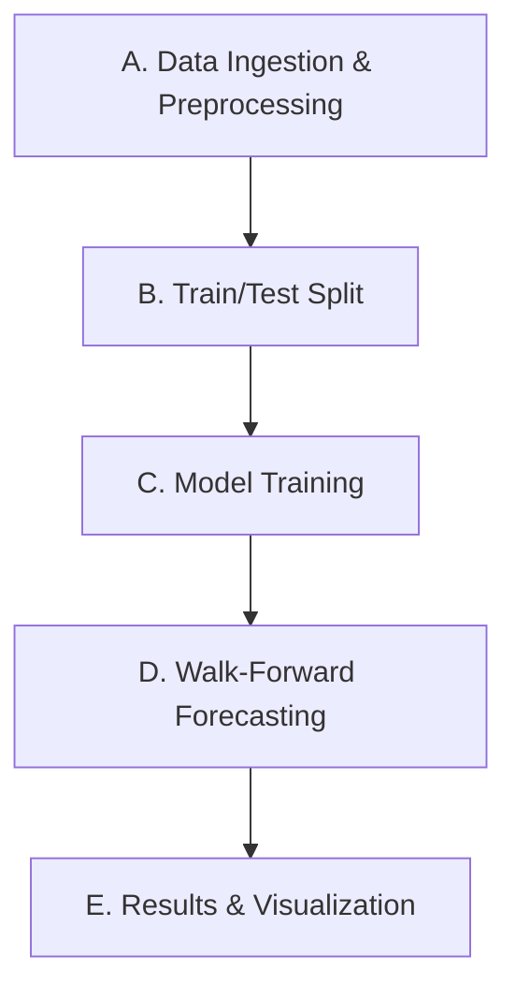

# Methodology Overview
Forecasting Intra-EU Migration to the Netherlands  
Benjamin Mikus

## 1. Introduction

This Methodology Overview describes the research design for forecasting monthly intra-EU migration to the Netherlands. It explains the data preparation, statistical and machine learning models, and evaluation procedures through which the research questions will be investigated.

The [project README](../README.md) provides a general outline of the pipeline as well as instructions for running the pipeline. The project builds on findings from the [literature review](Literature%20Review.md). Details on the dataset can be found in the [dataset README](../data/README.md), and the separate repository used to build the dataset used for this project can be found [here](https://github.com/ben-mikus/nl-immigration-data). The exploratory notebooks in `notebooks/` support key decisions made around feature engineering and model training. The individual modules can be found in `src/` and orchestrated through the corresponding commands in the `Makefile`.

### Research Question and Strategy

The main research question is:

**To what extent do statistical and machine learning models, supplemented with economic indicators, improve forecasts of monthly immigration associated with selected EU countries into the Netherlands at one-, three-, and six-month horizons, and how does their performance vary across Dutch business-cycle phases?**

Three subquestions guide the research:

- **RQ1**: How does Random Forest compare with Autoregression and AR-X when forecasting immigration one, three, and six months ahead?
- **RQ2**: Does including economic indicators from the Netherlands and countries of origin improve forecasts beyond immigration history and Dutch business-cycle information?
- **RQ3**: Are forecasting errors greater during unfavorable Dutch business-cycle conditions, and does model performance differ between favorable and unfavorable periods?

### Pipeline Overview

### Forecasting Pipeline

Figure 1 shows the five main stages of the forecasting pipeline, which can be executed together using `make all`.

*Figure 1. Overview of the forecasting pipeline.*

`src/data.py`, `src/split.py`, `src/train.py`, `src/predict.py`, and `src/results.py` together form the runnable pipeline, performing stages A through E, respectively. When the modules are run together, the pipeline begins by downloading the dataset and chronoligically splitting the data into train and test splits, reserving the final 60 months for testing. The models which are trained are `AutoREG` from `sktime`, an AR-X model with Fourier seasonailty built with `AutoREG` and `DeterministicProcess` from `statsmodels`, and `RandomForestRegressor` from `sklearn`. Trained models are saved as `.pkl` files, which are then used to generate one-, three-, and six-month-ahead forecasts through (fixed-model) walk-forward evaluation. Finally, the predictions are evaluated using Mean Absolute Error (MAE) and visualized alongside the observed immigration counts.

## 2. Dataset Description and Access

### Dataset Characteristics

The project uses a monthly panel dataset combining immigration statistics and economic information from Statistics Netherlands (CBS). The current dataset covers **Bulgaria, Poland, and Romania** from January 2010 through December 2025. It contains **576 observations and four columns**, with 192 monthly observations per country. The supplied dataset has no missing values or duplicate country-month combinations.

| Column | Description | Frequency |
| --- | --- | --- |
| `Period` | Observation month (`YYYYMM`) | Monthly |
| `Country` | Country identifier (Bulgaria, Poland, Romania) | *N/A* |
| `Immigration` | CBS monthly immigration count associated with each country; forecasting target | Monthly |
| `NL-CONJCLK` | Dutch CBS Conjunctuurklok business-cycle indicator | Monthly |

The Conjunctuurklok indicator represents economic conditions in the Netherlands and is shared across all three countries for each month. The dataset allows immigration patterns and forecasting performance to be examined separately by country.

### Data Sources and Reproducibility

The dataset was assembled using a separate [data-building repository](https://github.com/ben-mikus/nl-immigration-data), which documents the source tables, API filters, and data preparation procedures.

The underlying data comes from two CBS sources:

- **Immigration:** CBS tables [85484NED](https://opendata.cbs.nl/#/CBS/nl/dataset/85484NED/table) and [83518NED](https://opendata.cbs.nl/#/CBS/nl/dataset/83518NED/table), using monthly immigration counts for the three selected country categories.
- **Business cycle:** The [CBS Conjunctuurklok dashboard](https://www.cbs.nl/nl-nl/visualisaties/dashboard-economie/conjunctuurklok), downloaded as a CSV file.

The data-building process combines these sources into `panel_data.csv`, using the observation month and country as identifiers. The source configurations are documented in the data-building repository's [`config.py`](https://github.com/ben-mikus/nl-immigration-data/blob/main/config.py), while [`settings.py`](https://github.com/ben-mikus/nl-immigration-data/blob/main/settings.py) identifies the selected countries and indicators.

The forecasting repository downloads the assembled dataset using `make data`. The module additionally handles preprocessing, standardizing the monthly dates and adjusts the economic indicator for publication delays. Further details are available in the [dataset README](../data/README.md).

### Representativeness and Ethical Considerations

The dataset covers three selected EU countries and is not representative of immigration from the EU as a whole. Additionally, differences in CBS origin classifications and the absence of migration motives limit how the results can be interpreted. The dataset does not distinguish between protected demographic categories, such as sex or ethnicity, so subgroup-level fairness cannot be evaluated. Instead, descriptive statistics and forecasting performance will be reported separately for each country.

The use of publicly available, aggregated data limits direct privacy concerns. However, country-specific forecasts may still introduce risks of misinterpretation or stereotyping. These risks will be addressed through neutral reporting and clear communication of the study's limitations. Further discussion of data quality and representativeness is provided in the [dataset README](../data/README.md), while the [ELSA Report](../reports/ELSA%20Report.md) examines the broader ethical, legal, and societal implications.

## 3. Dataset Cleaning, Preprocessing, Transformation, and Splitting

### Data Cleaning and Transformation

The dataset is prepared using [`data.py`](../src/data.py), which downloads the assembled panel, saves an unmodified copy, and standardizes the `Period` column into a monthly date format. Observations are then sorted chronologically by country.

To account for publication delays, the Dutch Conjunctuurklok indicator is shifted forward by two months within each country. This prevents the models from using economic information that would not yet have been published at the forecast date. The initial two observations per country are consequently removed because their economic histories are unavailable, leaving **570 observations** for modeling.

The supplied dataset contains no missing values or duplicate country-month combinations. No additional imputation or outlier removal is performed. Further details on the original dataset and its limitations are provided in the [dataset README](../data/README.md).

### Chronological Data Splitting

The processed dataset is divided using [`split.py`](../src/split.py). Rather than randomly splitting observations, the module reserves the final 60 months for testing within each country, leaving all earlier observations for training.

| Dataset | Period | Observations |
| --- | --- | ---: |
| Training | March 2010–December 2020 | 390 (130 per country) |
| Testing | January 2021–December 2025 | 180 (60 per country) |

This chronological approach preserves the temporal structure of immigration data and prevents future target observations from entering the initial training sample. Separate country-specific models are fitted using [`train.py`](../src/train.py).

### Transformations and Leakage Prevention

Model-specific transformations are applied within the training pipeline. The AR-X model standardizes economic predictors using parameters estimated exclusively from the training data. Random Forest instead uses unscaled predictors alongside lagged immigration observations and seasonal Fourier features.

To reflect reporting delays, the training module also excludes the final month of immigration observations from the initial model-fitting history. During forecasting, [`predict.py`](../src/predict.py) uses only the available immigration history and publication-adjusted economic information. Future economic inputs are held at their most recently available values, and the fitted models are updated with newly available observations without refitting.

These procedures reduce the risk of data leakage during the walk-forward evaluation. However, historical revisions to the source statistics remain a limitation because the dataset does not contain real-time publication vintages.

## 4. Implemented Machine Learning Models

### Model Selection and Implementation

The project compares three forecasting models, each fitted separately for Bulgaria, Poland, and Romania. Their implementations are available in [`src/models/`](../src/models/).

| Model | Description | Purpose |
| --- | --- | --- |
| [AutoREG](../src/models/baseline.py) | Autoregressive model using 18 previous immigration observations | Establish a benchmark using immigration history alone |
| [AR-X with Fourier](../src/models/arx_fourier.py) | Autoregressive model using two immigration lags, economic indicators, and Fourier terms for annual seasonality | Evaluate whether economic information and explicit seasonality improve statistical forecasts |
| [Random Forest](../src/models/random_forest.py) | Ensemble regression model using lagged immigration, economic indicators, and seasonal features | Examine whether nonlinear relationships improve forecasting performance |

The AutoREG model provides a relatively simple statistical benchmark. AR-X extends this approach by incorporating economic conditions and seasonal patterns, while Random Forest allows more flexible relationships between predictors and immigration. Comparing these approaches helps establish whether additional information and model complexity improve forecasting accuracy.

### Hyperparameters and Training

The models are fitted using [`train.py`](../src/train.py), with configurations defined in [`config.py`](../src/config.py). Hyperparameters are predefined rather than selected through grid search or automated optimization. The AR-X model uses three Fourier harmonics, while Random Forest uses 200 trees, a minimum leaf size of three, and 80% feature subsampling. A fixed random seed ensures reproducibility.

No under-sampling, over-sampling, or synthetic data generation is applied. The complete available training history is retained, apart from observations excluded through preprocessing, publication-delay alignment, or lag construction. This preserves the chronological structure of the relatively small monthly datasets.

### Comparative Evaluation

All three models are evaluated using the same country-specific test periods and forecast horizons through [`predict.py`](../src/predict.py). Walk-forward evaluation generates one-, three-, and six-month-ahead forecasts at successive monthly origins. Newly available observations are incorporated into the forecasting histories without refitting the models.

Forecasts are compared against the same observed immigration counts, allowing consistent comparisons between models. Evaluation is conducted separately by country and forecasting horizon, with fewer observations available at longer horizons because predictions extending beyond the test period are excluded.

The primary evaluation measure is **Mean Absolute Error (MAE)**, which expresses the average forecasting error in immigration counts. **Weighted Absolute Percentage Error (WAPE)** is also reported to express the total absolute error relative to observed immigration volume, supporting comparisons between countries of different sizes. Both metrics are calculated in [`results.py`](../src/results.py), alongside observed-versus-predicted visualizations.

The current evaluation reports point estimates based on the available walk-forward forecasts. Additional resampling or uncertainty estimation is not implemented, so conclusions are limited to the observed test periods rather than a distribution of potential forecasting outcomes.
