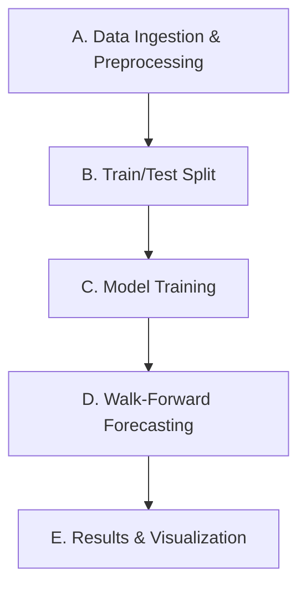

# Forecasting Intra-EU Migration to the Netherlands

Data Science and Society  
Benjamin Mikus

## Abstract

Forecasting immigration can support planning for housing, infrastructure, and public services in the Netherlands. This study examines the effectiveness of statistical and machine learning models in predicting monthly immigration associated with selected European Union countries at one-, three-, and six-month horizons. Using historical immigration records and macroeconomic indicators from origin and destination countries, the research compares autoregressive, seasonal statistical, and Random Forest models. Forecasting accuracy is assessed through chronological walk-forward evaluation using mean absolute error. The study additionally investigates whether economic indicators improve predictive performance and whether forecasting accuracy varies across Dutch business-cycle conditions.

## Introduction

Migration plays an important role in the demographic and economic development of the Netherlands. Immigration contributes to the Dutch labor supply while also influencing demand for housing, infrastructure, and public services. Consequently, anticipating changes in migration flows could provide valuable information to policymakers, municipalities, businesses, and researchers (State Commission Demographic Developments 2050, 2024).

However, forecasting migration remains challenging due to the complex relationships between historical migration patterns, economic conditions, and individual migration decisions. This project investigates whether statistical and machine learning models can improve short-term forecasts of monthly immigration associated with selected European Union countries into the Netherlands. Specifically, the project predicts monthly immigration counts at one-, three-, and six-month horizons, rather than individual migration decisions or motives.

Although improved forecasts could eventually support public planning, this project primarily serves as a research demonstration. Furthermore, country-specific forecasts risk reinforcing negative stereotypes or being interpreted beyond what the data supports. Transparent reporting of forecasting accuracy and limitations is therefore essential, particularly when considering potential applications affecting immigrants and receiving communities.

The overarching research question is: **To what extent do statistical and machine learning models, supplemented with economic indicators, improve forecasts of monthly immigration associated with selected EU countries into the Netherlands at one-, three-, and six-month horizons, and how does their performance vary across Dutch business-cycle phases?**

Three subquestions examine (1) differences in forecasting accuracy between statistical and machine learning models, (2) performance across favorable and unfavorable economic conditions, and (3) the additional predictive value of origin-country and destination-country economic indicators.

The remainder of this report presents the relevant literature, methodology, experimental results and discussion, followed by conclusions and limitations.

## Literature Review

Recent migration forecasting research demonstrates the potential of machine learning and macroeconomic indicators, although findings remain dependent on the migration context and forecasting methodology.

Carammia et al. (2022) demonstrated that adaptive machine learning models can outperform traditional statistical approaches when forecasting asylum applications, reporting an average relative error of 7% compared with 15.2% for ARIMA in one migration corridor. Similarly, Boss et al. (2024) found that a Random Forest–XGBoost ensemble outperformed statistical benchmarks when forecasting monthly asylum flows into the European Union. However, these findings concern asylum migration and cannot necessarily be generalized to intra-EU migration.

Research examining intra-EU migration provides stronger evidence for the relevance of economic indicators. Landesmann et al. (2015) identified historical migration and wage differentials as important determinants of intra-EU mobility. More recently, Barker and Bijak (2025) demonstrated the forecasting potential of macroeconomic indicators using a mixed-frequency Bayesian model. However, their approach does not directly establish predictive performance for monthly immigration counts.

Within the Dutch context, van Stiphout-Kramer et al. (2024) identified labor demand and business-cycle conditions as important historical drivers of migration, although their analysis does not establish the comparative forecasting accuracy of different models across economic conditions.

Collectively, these studies leave uncertainty regarding the relative performance of statistical and machine learning models for monthly intra-EU immigration into the Netherlands. This project addresses that gap by comparing models across multiple forecasting horizons, examining business-cycle-dependent accuracy, and evaluating the incremental predictive value of macroeconomic indicators. Further discussion of the scientific literature is provided in the repository's Literature Review.

## Methodology

### Research Design and Pipeline

This study adopts a comparative forecasting approach to evaluate the performance of statistical and machine learning models in predicting monthly immigration to the Netherlands from selected European Union countries. Three models are evaluated across one-, three-, and six-month forecasting horizons, with particular attention to the contribution of economic indicators and differences in forecasting accuracy across countries.

The methodology follows five stages: data ingestion and preprocessing, chronological train/test splitting, model training, walk-forward forecasting, and results evaluation. These stages are implemented through the Python modules in `src/` and orchestrated using the repository's `Makefile`, allowing the full pipeline to be executed using `make all`. Figure 1 illustrates the workflow, while the repository's *Methodology Overview* provides detailed implementation documentation.

*Figure 1. Overview of the forecasting pipeline.*

### Dataset and Preprocessing

The study uses a monthly panel dataset combining immigration statistics and economic information from Statistics Netherlands (CBS). The dataset covers Bulgaria, Poland, and Romania between January 2010 and December 2025, comprising 576 country-month observations, or 192 monthly observations per country. The forecasting target is the monthly immigration count associated with each country, while the current economic predictor is the Dutch Conjunctuurklok business-cycle indicator.

The dataset is assembled through a separate repository, `nl-immigration-data`, which documents the original CBS sources and data construction procedures. Within the forecasting pipeline, `src/data.py` downloads the assembled dataset, standardizes the monthly date format, and sorts observations chronologically by country.

To reflect the delayed publication of economic statistics, the Conjunctuurklok indicator is shifted forward by two months. The initial observations without complete economic histories are subsequently excluded, leaving 570 observations. No additional imputation or outlier removal is performed.

The processed data is divided chronologically using `src/split.py`. The final 60 months per country, January 2021 through December 2025, are reserved for out-of-sample evaluation, while March 2010 through December 2020 forms the initial training period. This preserves the temporal structure of the data and prevents future immigration observations from entering the initial training sample. Further information on data sources and preprocessing is provided in Sections 2 and 3 of the *Methodology Overview*.

### Model Selection and Training

Three forecasting models are implemented independently for each country using `src/train.py`, with model configurations defined in `src/config.py`.

The first model, **AutoREG**, provides an autoregressive benchmark using the preceding 18 monthly immigration observations. It establishes a reference against which the additional complexity and explanatory information introduced by alternative models can be evaluated.

The second model, **AR-X with Fourier seasonality**, incorporates two autoregressive lags, economic predictors, and three Fourier harmonics representing annual seasonal patterns. This specification extends autoregression by explicitly modeling seasonal variation and economic conditions. Economic predictors are standardized using parameters estimated exclusively from the initial training sample.

The third model, **Random Forest**, is an ensemble regression approach incorporating lagged immigration observations, economic predictors, and seasonal Fourier features. Unlike the linear autoregressive specifications, Random Forest can capture nonlinear relationships and interactions between predictors without explicitly defining their functional forms.

Model hyperparameters are predefined rather than selected through automated optimization. Random Forest uses 200 trees, a minimum leaf size of three, and 80% feature subsampling, with a fixed random seed for reproducibility. No synthetic sampling or resampling of the training data is performed. Trained models are saved as `.pkl` artifacts for subsequent forecasting. Section 4 of the *Methodology Overview* documents the model specifications and implementations in `src/models/`.

### Walk-Forward Forecasting and Evaluation

Out-of-sample performance is assessed using an expanding-history, fixed-model walk-forward evaluation implemented in `src/predict.py`. At successive monthly forecast origins, each model generates predictions at one-, three-, and six-month horizons using the information available at that origin. Newly available immigration observations are incorporated into the forecasting histories without re-estimating model parameters.

To account for reporting delays, immigration observations are assumed to become available one month after their reference period. Economic predictors are similarly restricted by their publication-adjusted availability, with future economic inputs held constant at the most recently available values. These restrictions reduce the risk of using information unavailable at the forecast origin.

All three models are evaluated against the same country-specific test periods and forecasting horizons. Predictions extending beyond the test period are excluded, resulting in fewer evaluated forecasts at longer horizons.

The primary performance metric is **Mean Absolute Error (MAE)**, which measures the average absolute deviation between predicted and observed immigration counts. **Weighted Absolute Percentage Error (WAPE)** is additionally reported to express aggregate absolute forecasting error relative to observed immigration volume, facilitating comparisons across countries with different migration volumes.

Metrics and observed-versus-predicted visualizations are generated through `src/results.py`. Results are reported separately by country, model, and forecasting horizon. The evaluation uses the observed test periods without additional resampling or uncertainty estimation. Detailed forecasting procedures and model configurations are available in the repository's *Methodology Overview* and source code.

## Results, Interpretation, and Discussion

### Overall Forecasting Performance

The forecasting performance of the three models was evaluated across Bulgaria, Poland, and Romania at one-, three-, and six-month forecasting horizons. Each country was evaluated over a 60-month out-of-sample period, with forecasts generated through a fixed-model walk-forward procedure. Performance was assessed using Mean Absolute Error (MAE) and Weighted Absolute Percentage Error (WAPE), with lower values indicating greater forecasting accuracy.

Table 1 summarizes WAPE across all country-model-horizon combinations. Corresponding MAE values and individual forecast comparisons are available in the repository's `results/` directory and can be reproduced using `src/predict.py` and `src/results.py`.

**Table 1. Out-of-sample forecasting accuracy by country, model, and horizon (WAPE %).**

| Country | Model | 1 month | 3 months | 6 months |
|---|---|---:|---:|---:|
| Bulgaria | AutoREG | **11.96** | **13.81** | **15.57** |
| | AR-X Fourier | 12.46 | 16.64 | 20.55 |
| | Random Forest | 18.04 | 20.69 | 21.14 |
| Poland | AutoREG | 10.18 | 11.77 | 13.37 |
| | AR-X Fourier | **8.13** | **9.28** | **10.74** |
| | Random Forest | 10.06 | 10.93 | 11.69 |
| Romania | AutoREG | **14.51** | **14.31** | **13.30** |
| | AR-X Fourier | 19.27 | 21.73 | 21.65 |
| | Random Forest | 20.76 | 23.51 | 26.74 |

The results reveal differences in forecasting accuracy across both countries and model architectures. For Bulgaria and Romania, the autoregressive baseline achieved the lowest WAPE at all three horizons. In contrast, AR-X Fourier achieved the lowest WAPE for Poland, where its errors ranged from 8.13% at the one-month horizon to 10.74% at the six-month horizon. Random Forest did not outperform both statistical alternatives at any evaluated country-horizon combination.

Forecasting accuracy also varied with the prediction horizon. For most country-model combinations, WAPE increased as the forecasting horizon extended from one to six months. An exception was the Romanian autoregressive baseline, for which WAPE decreased from 14.51% to 13.30%.

**[Insert Figure 2: Comparison of WAPE across forecasting horizons, with separate panels for Bulgaria, Poland, and Romania.]**

**[Interpretation to complete: Discuss the relative performance of the three architectures, the differences observed between countries, and the extent to which the findings meet your expectations. Refer to selected observed-versus-predicted plots where they provide additional evidence.]**

### Contribution of Economic Indicators

The second analysis examines whether incorporating economic information improves forecasting accuracy beyond what can be achieved using historical immigration observations and seasonal features. The current forecasting implementation incorporates the Dutch Conjunctuurklok indicator into the AR-X Fourier and Random Forest models.

Because the models differ in their underlying specifications, the performance comparison in Section 4.1 does not independently establish the contribution of economic indicators. A controlled comparison is therefore required to assess their incremental predictive value.

**[Insert Table 2: Forecasting accuracy with and without economic indicators, holding other model specifications constant. Report changes in MAE or WAPE by country and forecasting horizon.]**

**[Results and interpretation to complete: Identify whether economic indicators improved or reduced forecasting accuracy, whether the effect differed across countries or horizons, and what the findings suggest about their predictive contribution.]**

### Performance Across Business-Cycle Conditions

The third analysis investigates whether forecasting accuracy varies across Dutch business-cycle conditions. This comparison is intended to establish whether the models demonstrate different levels of reliability under favorable and unfavorable economic circumstances.

The evaluation uses the individual out-of-sample forecasts produced by `src/predict.py`, alongside the Dutch Conjunctuurklok indicator. Forecasting errors are compared across economic conditions using the evaluation metrics established in the methodology.

**[Specify the classification of business-cycle conditions, including whether conditions are measured at the forecast origin or target month.]**

**[Insert Table 3 or Figure 3: Forecasting accuracy by business-cycle condition, model, and potentially forecasting horizon. Include sample sizes.]**

**[Results and interpretation to complete: Describe differences in forecasting accuracy across economic conditions, identify any consistent patterns, and consider whether the available observations support meaningful conclusions.]**

### Discussion and Model Reliability

The preceding analyses provide a basis for evaluating the relative strengths and limitations of the forecasting approaches. In particular, the overall performance results demonstrate that the ranking of the three models differs across the selected countries, with no single architecture achieving the lowest error in every country.

An important consideration is the relationship between model complexity and forecasting accuracy. The Random Forest model incorporates nonlinear modeling capabilities, while AR-X Fourier explicitly represents seasonality and economic predictors. However, the additional complexity of these approaches did not consistently produce lower forecasting errors than the autoregressive baseline.

**[Discussion to complete: Consider potential explanations for the observed model rankings, drawing on the characteristics of the immigration series, model specifications, and relevant findings from the Literature Review. Distinguish explanations supported by additional evidence from hypotheses.]**

The evaluation procedure also introduces considerations regarding the reliability and generalizability of the results. Walk-forward forecasting incorporates newly available observations into model histories, but model parameters remain fixed after initial training. Consequently, the results describe the performance of models trained on an initial historical period rather than models periodically retrained using newly available observations.

Furthermore, the evaluation is limited to three countries and a single five-year test period. Although the 60-month evaluation provides multiple forecast origins, no uncertainty estimation or statistical significance testing is currently performed. Differences in observed forecasting errors should therefore be interpreted within the scope of the evaluated sample.

**[Discussion to complete: Integrate the findings from Sections 4.2 and 4.3, assess whether the results are consistent with relevant literature, and consider the implications for forecasting reliability. Identify any remaining limitations that materially affect the interpretation of the results.]**

The findings and limitations established in this section provide the foundation for the conclusions and recommendations for future research presented in the following section.