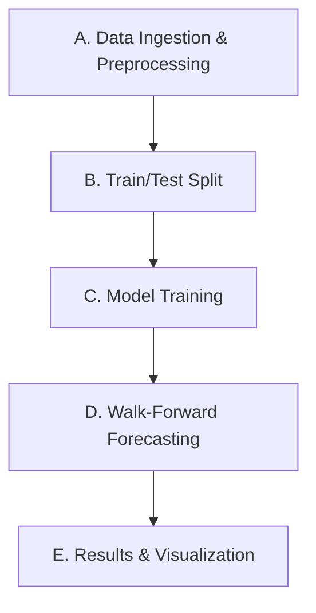
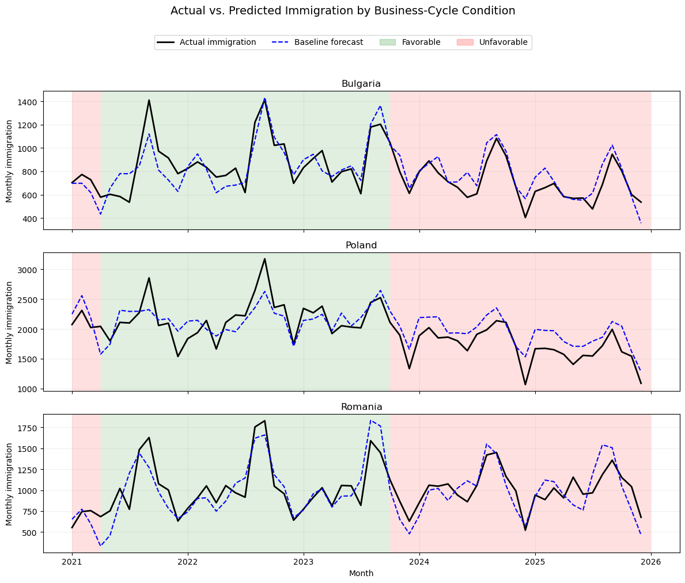

# Forecasting Intra-EU Migration to the Netherlands

Data Science and Society  
Benjamin Mikus

## Abstract

Forecasting immigration can support planning for housing, infrastructure, and public services in the Netherlands. This study evaluates statistical and machine learning models for forecasting monthly immigration from Bulgaria, Poland, and Romania at one-, three-, and six-month horizons. Using historical immigration records and the Dutch Conjunctuurklok business-cycle indicator, the research compares autoregressive, seasonal statistical, and Random Forest models through chronological walk-forward evaluation. The autoregressive baseline generally achieved the strongest forecasting performance, while incorporating the economic indicator produced inconsistent improvements. Forecasting accuracy also varied across business-cycle conditions, although no consistent relationship emerged across countries. These findings highlight the importance of country-specific evaluation and competitive statistical benchmarks.

## Introduction

Migration plays an important role in the demographic and economic development of the Netherlands. Immigration contributes to the Dutch labor supply while also influencing demand for housing, infrastructure, and public services. Consequently, anticipating changes in migration flows could provide valuable information to policymakers, municipalities, businesses, and researchers (State Commission Demographic Developments 2050, 2024).

However, forecasting migration remains challenging due to the complex relationships between historical migration patterns, economic conditions, and individual migration decisions. This project investigates whether statistical and machine learning models can improve short-term forecasts of monthly immigration from Bulgaria, Poland, and Romania into the Netherlands. Specifically, the project predicts monthly immigration counts at one-, three-, and six-month horizons, rather than individual migration decisions or motives.

Although improved forecasts could eventually support public planning, this project primarily serves as a research demonstration. Furthermore, country-specific forecasts risk reinforcing negative stereotypes or being interpreted beyond what the data supports. Transparent reporting of forecasting accuracy and limitations is therefore essential, particularly when considering potential applications affecting immigrants and receiving communities.

The overarching research question is: **To what extent do statistical and machine learning models, supplemented with the Dutch Conjunctuurklok business-cycle indicator, improve forecasts of monthly immigration from selected EU countries into the Netherlands at one-, three-, and six-month horizons, and how does their performance vary across Dutch business-cycle conditions?**

Three subquestions examine (1) differences in forecasting accuracy between statistical and machine learning models, (2) performance across favorable and unfavorable Dutch business-cycle conditions, and (3) the additional predictive value of the Conjunctuurklok indicator.

The remainder of this report presents the relevant literature, methodology, experimental results and discussion, followed by conclusions and limitations.

## Literature Review

Recent migration forecasting research demonstrates the potential of machine learning and macroeconomic indicators, although findings remain dependent on the migration context and forecasting methodology.

Carammia et al. (2022) demonstrated that adaptive machine learning models can outperform traditional statistical approaches when forecasting asylum applications, reporting an average relative error of 7% compared with 15.2% for ARIMA in one migration corridor. Similarly, Boss et al. (2024) found that a Random Forest–XGBoost ensemble outperformed statistical benchmarks when forecasting monthly asylum flows into the European Union. However, these findings concern asylum migration and cannot necessarily be generalized to intra-EU migration.

Research examining intra-EU migration provides stronger evidence for the relevance of economic indicators. Landesmann et al. (2015) identified historical migration and wage differentials as important determinants of intra-EU mobility. More recently, Barker and Bijak (2025) demonstrated the forecasting potential of macroeconomic indicators using a mixed-frequency Bayesian model. However, their approach does not directly establish predictive performance for monthly immigration counts.

Within the Dutch context, van Stiphout-Kramer et al. (2024) identified labor demand and business-cycle conditions as important historical drivers of migration, although their analysis does not establish the comparative forecasting accuracy of different models across economic conditions.

Collectively, these studies leave uncertainty regarding the relative performance of statistical and machine learning models for monthly intra-EU immigration into the Netherlands. This project addresses that gap by comparing models across multiple forecasting horizons, examining business-cycle-dependent accuracy, and evaluating the incremental predictive value of the Dutch Conjunctuurklok indicator.

## Methodology

### Research Design and Pipeline

This study adopts a comparative forecasting approach to evaluate the performance of statistical and machine learning models in predicting monthly immigration to the Netherlands from selected European Union countries. Three models are evaluated across one-, three-, and six-month forecasting horizons, with particular attention to the contribution of economic indicators and differences in forecasting accuracy across countries.

The methodology follows five stages: data ingestion and preprocessing, chronological train/test splitting, model training, walk-forward forecasting, and results evaluation. These stages are implemented through the Python modules in `src/` and orchestrated using the repository's `Makefile`, allowing the full pipeline to be executed using `make all`. Figure 1 illustrates the workflow, while the repository's *Methodology Overview* provides detailed implementation documentation.

*Figure 1. Overview of the forecasting pipeline.*

### Dataset and Preprocessing

The study uses a monthly panel dataset combining immigration statistics and economic information from Statistics Netherlands (CBS). The dataset covers Bulgaria, Poland, and Romania between January 2010 and December 2025, comprising 576 country-month observations, or 192 monthly observations per country. The forecasting target is the monthly immigration count associated with each country, while the current economic predictor is the Dutch Conjunctuurklok business-cycle indicator.

The dataset is assembled through a separate repository, `nl-immigration-data`, which documents the original CBS sources and data construction procedures. Within the forecasting pipeline, `src/data.py` downloads the assembled dataset, standardizes the monthly date format, and sorts observations chronologically by country.

To reflect the delayed publication of economic statistics, the Conjunctuurklok indicator is shifted forward by two months. The initial observations without complete economic histories are subsequently excluded, leaving 570 observations. No additional imputation or outlier removal is performed.

The processed data is divided chronologically using `src/split.py`. The final 60 months per country, January 2021 through December 2025, are reserved for out-of-sample evaluation, while March 2010 through December 2020 forms the initial training period. This preserves the temporal structure of the data and prevents future immigration observations from entering the initial training sample. Further information on data sources and preprocessing is provided in Sections 2 and 3 of the *Methodology Overview*.

### Model Selection and Training

Three forecasting models are implemented independently for each country using `src/train.py`, with model configurations defined in `src/config.py`.

The first model, **AutoREG**, provides an autoregressive benchmark using the preceding 18 monthly immigration observations. It establishes a reference against which the additional complexity and explanatory information introduced by alternative models can be evaluated.

The second model, **AR-X with Fourier seasonality**, incorporates two autoregressive lags, economic predictors, and three Fourier harmonics representing annual seasonal patterns. This specification extends autoregression by explicitly modeling seasonal variation and economic conditions. Economic predictors are standardized using parameters estimated exclusively from the initial training sample.

The third model, **Random Forest**, is an ensemble regression approach incorporating lagged immigration observations, economic predictors, and seasonal Fourier features. Unlike the linear autoregressive specifications, Random Forest can capture nonlinear relationships and interactions between predictors without explicitly defining their functional forms.

Model hyperparameters are predefined rather than selected through automated optimization. Random Forest uses 200 trees, a minimum leaf size of three, and 80% feature subsampling, with a fixed random seed for reproducibility. No synthetic sampling or resampling of the training data is performed. Trained models are saved as `.pkl` artifacts for subsequent forecasting. Section 4 of the *Methodology Overview* documents the model specifications and implementations in `src/models/`.

### Walk-Forward Forecasting and Evaluation

Out-of-sample performance is assessed using an expanding-history, fixed-model walk-forward evaluation implemented in `src/predict.py`. At successive monthly forecast origins, each model generates predictions at one-, three-, and six-month horizons using the information available at that origin. Newly available immigration observations are incorporated into the forecasting histories without re-estimating model parameters.

To account for reporting delays, immigration observations are assumed to become available one month after their reference period. Economic predictors are similarly restricted by their publication-adjusted availability, with future economic inputs held constant at the most recently available values. These restrictions reduce the risk of using information unavailable at the forecast origin.

All three models are evaluated against the same country-specific test periods and forecasting horizons. Predictions extending beyond the test period are excluded, resulting in fewer evaluated forecasts at longer horizons.

The primary performance metric is **Mean Absolute Error (MAE)**, which measures the average absolute deviation between predicted and observed immigration counts. **Weighted Absolute Percentage Error (WAPE)** is additionally reported to express aggregate absolute forecasting error relative to observed immigration volume, facilitating comparisons across countries with different migration volumes.

Metrics and observed-versus-predicted visualizations are generated through `src/results.py`. Results are reported separately by country, model, and forecasting horizon. The evaluation uses the observed test periods without additional resampling or uncertainty estimation. Detailed forecasting procedures and model configurations are available in the repository's *Methodology Overview* and source code.

## Results, Interpretation, and Discussion

### Overall Forecasting Performance

The three forecasting models were evaluated across Bulgaria, Poland, and Romania at one-, three-, and six-month horizons. Out-of-sample performance was assessed using Mean Absolute Error (MAE) and Weighted Absolute Percentage Error (WAPE), with lower values indicating greater forecasting accuracy. Each model was evaluated over a five-year test period using the fixed-model walk-forward procedure described in the methodology.

Table 1 presents the forecasting performance obtained using the Dutch Conjunctuurklok indicator. The results are produced by `src/predict.py` and `src/results.py`, with the individual forecasts and evaluation metrics stored in the repository's `results/` directory.

**Table 1. Out-of-sample forecasting accuracy by country, model, and horizon (WAPE %).**

| Country | Model | 1 month | 3 months | 6 months |
|---|---|---:|---:|---:|
| Bulgaria | AutoREG | **11.34** | **12.94** | **14.31** |
| | AR-X Fourier | 12.37 | 16.49 | 20.33 |
| | Random Forest | 17.88 | 20.89 | 23.87 |
| Poland | AutoREG | 10.26 | 12.38 | 13.45 |
| | AR-X Fourier | **8.06** | **9.09** | **10.31** |
| | Random Forest | 9.67 | 10.65 | 11.57 |
| Romania | AutoREG | **14.52** | **14.25** | **13.26** |
| | AR-X Fourier | 19.39 | 21.76 | 21.42 |
| | Random Forest | 20.61 | 24.62 | 28.91 |

The results demonstrate differences in forecasting accuracy across countries and model architectures. AutoREG achieved the lowest WAPE across all three horizons for Bulgaria and Romania, while AR-X Fourier achieved the lowest WAPE for Poland. Random Forest did not achieve the lowest error for any evaluated country-horizon combination.

The autoregressive baseline therefore demonstrated the strongest overall performance across the selected countries, achieving the lowest WAPE in six of nine country-horizon comparisons. However, the results also suggest that no single model architecture consistently performs best across all countries.

Forecasting accuracy generally decreased as the prediction horizon increased. This pattern was particularly visible in Bulgaria, where baseline WAPE increased from 11.34% at the one-month horizon to 14.31% at the six-month horizon. Poland demonstrated a similar pattern across all three models. In contrast, Romania's baseline WAPE decreased from 14.52% to 13.26% as the horizon extended, indicating that the relationship between forecasting horizon and accuracy was not uniform.

These findings suggest that the additional complexity of nonlinear modeling or explicit seasonal and economic features does not necessarily translate into improved forecasting accuracy. Differences in the underlying immigration series may influence which model specifications are most appropriate. Nevertheless, the results alone do not establish which characteristics explain the country-specific differences.

### Contribution of Economic Indicators

To investigate the additional predictive value of economic information, forecasting performance was compared between configurations with and without the Dutch Conjunctuurklok indicator. The comparison focuses on AR-X Fourier and Random Forest, as both models can incorporate economic predictors.

Table 2 summarizes the resulting changes in WAPE. Negative values indicate lower forecasting error when the indicator was included.

**Table 2. Change in WAPE after incorporating Conjunctuurklok (percentage points).**

| Country | Model | 1 month | 3 months | 6 months |
|---|---|---:|---:|---:|
| Bulgaria | AR-X Fourier | +0.16 | +0.05 | −0.08 |
| | Random Forest | −0.18 | +1.01 | +1.85 |
| Poland | AR-X Fourier | +0.01 | −0.21 | −0.54 |
| | Random Forest | +0.16 | −0.48 | −1.03 |
| Romania | AR-X Fourier | −0.03 | +0.30 | +0.65 |
| | Random Forest | −0.37 | −0.49 | −0.23 |

The results reveal no consistent improvement from incorporating the Conjunctuurklok indicator. For Poland, both models demonstrated lower errors at the three- and six-month horizons. In contrast, the indicator was associated with higher errors for Bulgaria's Random Forest at longer horizons and Romania's AR-X Fourier at three and six months.

These findings provide limited evidence that the selected economic indicator consistently improves immigration forecasts. However, small differences in the autoregressive baseline between the experimental runs indicate that the comparison may not fully isolate the indicator's contribution. Consequently, the results should be considered exploratory rather than definitive evidence of its predictive value.

### Performance Across Business-Cycle Conditions

To investigate whether forecasting accuracy varies across Dutch business-cycle conditions, an additional analysis was conducted using the autoregressive baseline, selected based on its overall performance. Individual forecasts were compared against observed immigration values and categorized according to contemporaneous favorable or unfavorable economic conditions, using the original, unshifted Conjunctuurklok values.

Table 3 presents the resulting MAE values across countries and horizons.

**Table 3. Baseline MAE under favorable and unfavorable business-cycle conditions.**

| Country | Horizon | Favorable | Unfavorable |
|---|---|---:|---:|
| Bulgaria | 1 month | 105.68 | 74.67 |
| | 3 months | 106.08 | 99.88 |
| | 6 months | 110.94 | 119.79 |
| Poland | 1 month | 186.84 | 216.74 |
| | 3 months | 200.12 | 288.10 |
| | 6 months | 204.35 | 325.06 |
| Romania | 1 month | 151.34 | 142.30 |
| | 3 months | 150.76 | 140.46 |
| | 6 months | 164.65 | 109.98 |

The results reveal different patterns across countries. Poland consistently demonstrated higher forecasting errors during unfavorable economic conditions, with the difference increasing at longer forecasting horizons. Romania displayed the opposite relationship, with lower MAE during unfavorable conditions at all three horizons. Bulgaria demonstrated a mixed pattern, with lower errors during unfavorable conditions at shorter horizons but higher errors at the six-month horizon.

*Figure 3: Actual versus predicted immigration, with background shading indicating Dutch business-cycle conditions. Three country panels.*

These differences suggest that forecasting accuracy may vary with economic conditions, although the direction of this relationship is not consistent across countries. The analysis is descriptive and does not establish that business-cycle conditions directly cause differences in forecasting accuracy.

### Discussion and Model Reliability

Collectively, the findings indicate that historical immigration observations provide a useful foundation for forecasting monthly intra-EU immigration to the Netherlands. The autoregressive baseline demonstrated competitive performance across the evaluated countries, while more complex statistical and machine learning approaches provided improvements only in selected circumstances.

The results also highlight the importance of country-specific forecasting behavior. Although AR-X Fourier performed best for Poland, the same model did not outperform the baseline for Bulgaria or Romania. Similarly, Random Forest's ability to capture nonlinear relationships did not consistently result in greater forecasting accuracy. These findings illustrate the limitations of assuming that model complexity necessarily produces improved predictions.

The economic-indicator experiment further demonstrates the uncertainty surrounding the predictive contribution of macroeconomic information. While incorporating Conjunctuurklok improved selected forecasts, the effect was inconsistent across countries and horizons. This does not establish that economic indicators are generally unhelpful, particularly because only one indicator was examined and the experimental comparisons may not be fully controlled.

The business-cycle analysis provides an additional perspective on forecasting reliability. Differences in MAE between favorable and unfavorable economic conditions were observable, particularly for Poland. However, the contrasting patterns across countries prevent a general conclusion that unfavorable conditions consistently reduce forecasting accuracy. Moreover, the analysis evaluates only the autoregressive baseline and therefore cannot establish whether alternative models would demonstrate similar sensitivity.

Several methodological limitations affect the interpretation of these results. Model parameters remain fixed throughout walk-forward evaluation, meaning the study does not assess whether periodic retraining could improve performance. Furthermore, the evaluation covers three countries and a single five-year test period, limiting the generalizability of the findings. No statistical significance testing or uncertainty estimation was performed, and differences between business-cycle conditions may reflect other characteristics of the evaluated periods.

Despite these limitations, the project provides a reproducible comparison of statistical and machine learning approaches across multiple immigration series and forecasting horizons. The findings demonstrate the value of evaluating models against a competitive autoregressive benchmark and establish a foundation for further investigation using additional economic indicators, alternative model configurations, and more extensive validation procedures.

## References

Barker, E., & Bijak, J. (2025). Mixed-frequency VAR: A new approach to predicting and analysing future migration in Europe using macroeconomic data. *Data & Policy, 7*, Article e3. https://doi.org/10.1017/dap.2024.82

Boss, K., Groeger, A., Heidland, T., Kruger, F., & Zheng, C. (2024). Forecasting bilateral asylum seeker flows with high-dimensional data and machine learning techniques. *Journal of Economic Geography, 25*(1), 3–19. https://doi.org/10.1093/jeg/lbae023

Carammia, M., Iacus, S. M., & Wilkin, T. (2022). Forecasting asylum-related migration flows with machine learning and data at scale. *Scientific Reports, 12*, Article 1457. https://doi.org/10.1038/s41598-022-05241-8

Landesmann, M., Leitner, S. M., & Mara, I. (2015). *Intra-EU mobility and push and pull factors in EU labour markets: Estimating a panel VAR model* (wiiw Working Paper No. 120). The Vienna Institute for International Economic Studies. https://wiiw.ac.at/intra-eu-mobility-and-push-and-pull-factors-in-eu-labour-markets-estimating-a-panel-var-model-dlp-3671.pdf

State Commission Demographic Developments 2050. (2024). *Moderate growth: Report of the State Commission Demographic Developments 2050*. https://www.government.nl/documents/2024/01/15/moderate-growth

van Stiphout-Kramer, B., Hendriks, B., Meijerink, G., van der Plaat, M., & van Sonsbeek, J.-M. (2024). *Economic dynamics and migration*. CPB Netherlands Bureau for Economic Policy Analysis. https://doi.org/10.13140/RG.2.2.28899.16166